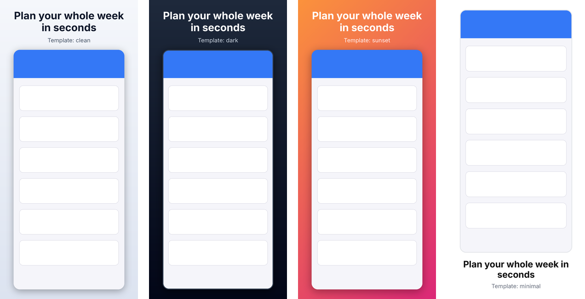
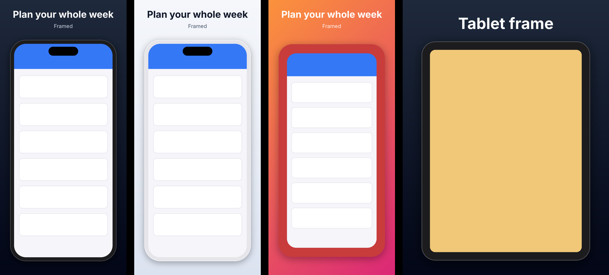

# AppPreviewGenerator

`apppreview` is a CLI that turns raw app screenshots into **App Store and Google Play
screenshots that pass store validation**. It is built for developers and AI agents
alike: every command has `--json` output and predictable exit codes.

## Install

```bash
pipx install git+https://github.com/dev101911/apppreviewgenerator
# or run without installing
uvx --from git+https://github.com/dev101911/apppreviewgenerator apppreview --help
```

Requires Python 3.10+.

## Quickstart

```bash
# What can I target?
apppreview targets                      # all Apple and Google targets
apppreview targets apple.iphone-6.9     # full spec for one target

# Are my screenshots compliant?
apppreview validate shots/*.png --target apple.iphone-6.9

# Make them compliant for several stores at once
apppreview generate shots/*.png \
  -t apple.iphone-6.9 -t apple.ipad-13 -t google.phone \
  --out store-assets --background auto

# Which targets does an image already fit?
apppreview identify shot.png

# Styled marketing screenshot with a caption
apppreview generate shot.png -t apple.iphone-6.9 --template dark --caption "Plan your week"
```

`generate` writes `OUT/<target-id>/NN_<name>.png` and re-validates every file it writes.

| Option | Meaning |
|---|---|
| `--mode fit` (default) | Scale to fit, letterbox with `--background` |
| `--mode fill` | Scale to cover, center-crop |
| `--mode stretch` | Scale to exact size, distorting if needed |
| `--background` | Color name, `#RRGGBB`, or `auto` (average edge color). Also used to flatten transparency. |
| `--format` | `png` (default) or `jpeg` |
| `--size WxH` | Force a specific accepted size, e.g. `1290x2796` |
| `--dry-run` | Show what would be written |
| `--template` | Place screenshots on a styled template (see below) |
| `--caption`, `--subtitle` | Text per image, in input order (implies the `clean` template) |

## Templates



Templates put your screenshot on a styled canvas with a caption and optional subtitle.
All sizes are proportional to the canvas, so one template works for every device and
orientation. Captions shrink to fit and wrap automatically.

```bash
apppreview templates            # built-in: clean, dark, sunset, minimal
apppreview templates dark       # show every setting
apppreview schema template      # JSON Schema for writing your own
```

Write your own template as YAML, starting from a built-in one:

```yaml
# brand.yaml
extends: dark
background:
  gradient: {from: "#4F46E5", to: "#0EA5E9", angle: 135}   # or {color: ...} or {image: bg.png}
caption: {color: "#FFFFFF", font: fonts/Brand-Bold.ttf, size: 0.08}
subtitle: {color: "#E0E7FF"}
caption_position: top            # or bottom
screenshot: {max_width: 0.8, corner_radius: 0.05, shadow: {blur: 0.03}}
```

The bundled default font is [Inter](https://github.com/rsms/inter) (SIL Open Font License).
Templates are rejected for targets where stores forbid added text or backgrounds
(Wear OS, Android Automotive, the Play app icon).

### Device frames



Put screenshots inside a device with `--frame` or `screenshot.frame` in a template:

```bash
apppreview frames                                   # auto, phone, tablet
apppreview generate shot.png -t apple.iphone-6.9 --frame phone --caption "Plan your week"
```

```yaml
screenshot:
  frame: phone                       # or auto / tablet / path to your own frame
  # frame: {name: phone, color: "#E5E5EA", island: false}
```

Built-in frames are drawn to fit each screenshot exactly, in portrait or landscape. To
use real device artwork, such as the product bezels from Apple Design Resources
(subject to Apple's terms), point `frame` at a PNG whose screen area is transparent. The
screen is found automatically. If that doesn't work for your image, use a manifest:

```yaml
# iphone-frame.yaml
image: my-phone-frame.png
screen: [72, 69, 1206, 2622]          # x, y, width, height of the screen in the PNG (example values)
```

Frames are rejected for Wear OS and Android Automotive, where Google forbids them.

## Project config: `apppreview build`

For a full store listing, describe every screen, target and locale in `apppreview.yaml`:

```bash
apppreview init        # writes a commented starter apppreview.yaml
apppreview build       # renders everything, then validates each set
apppreview build -t apple.iphone-6.9 -l de-DE --dry-run
```

```yaml
version: 1
out: store-screenshots
targets: [apple.iphone-6.9, apple.ipad-13, google.phone]
locales: [en-US, de-DE]
template: clean                     # name, path, or inline {extends: ..., ...}
screens:
  - id: home
    source: shots/{locale}/home.png  # {locale}, {target}, {screen} are substituted
    caption: {en: "Plan your week", de: "Plane deine Woche"}
  - id: detail
    source:                          # per-target sources; globs allowed
      apple.ipad-*: shots/{locale}/ipad/detail.png
      default: shots/{locale}/detail.png
    caption: {default: "Every detail, one tap away"}
    template: {caption_position: bottom}   # per-screen overrides
```

Output goes to `out/<locale>/<target>/NN_<screen>.png`. Captions fall back from
`de-DE` to `de` to `default`. All missing source files are reported at once, before
anything is rendered. Run `apppreview schema config` for the JSON Schema.

## Localization

- **Captions per locale.** Captions and titles take a mapping of locale to text. A missing
  locale falls back to its language, then to `default`.
- **Fonts per locale.** The bundled Inter font covers Latin, Greek and Cyrillic. For other
  scripts, set a font in `locale_overrides`; any template setting can be overridden by
  locale or language:

  ```yaml
  locale_overrides:
    ja: {caption: {font: fonts/NotoSansJP-Bold.otf}, subtitle: {font: fonts/NotoSansJP-Regular.otf}}
    ar: {caption: {font: fonts/NotoSansArabic-Bold.ttf}}
  ```

  [Noto](https://fonts.google.com/noto) fonts cover almost every language. If a caption has
  characters the font can't draw, the output gets a warning instead of silently showing boxes.
- **Right-to-left and complex scripts.** Arabic, Hebrew, Persian and Urdu are shaped and
  laid out right to left, with the template's left/right alignment mirrored (needs libraqm,
  which Pillow's wheels bundle). CJK text, which has no spaces, wraps between characters.
- **Store locale codes.** The stores spell locales differently (`ja` vs `ja-JP`, `he` vs
  `iw-IL`, `zh-Hans` vs `zh-CN`). `build` warns about locales a store doesn't support, and
  `apppreview locales ja-JP` shows each store's code. One-off commands take `--locale`.


## Store graphics and icons

Render the Google Play feature graphic (1024×500) and Android TV banner (1280×720)
from your app name, an optional tagline, and your icon, styled by any template:

```bash
apppreview graphic -t google.feature-graphic --title "Weekly Planner" \
  --subtitle "Plan your whole week in seconds" --icon icon.png --template sunset
apppreview graphic -t google.tv-banner --title "Weekly Planner" --icon icon.png -o banner.png
```


Content stays inside the central 80% because Google crops feature graphics in some
placements. In `apppreview.yaml`, add them under `graphics:` with localized text:

```yaml
graphics:
  - target: google.feature-graphic
    title: Weekly Planner
    subtitle: {en: "Plan your whole week in seconds", de: "Plane deine Woche in Sekunden"}
    icon: assets/icon.png
    template: {extends: sunset}      # optional overrides of the config's template
```

App icons are plain resizes: `apppreview generate icon.png -t google.icon -t apple.icon`
gives a 512×512 Play icon (transparency kept) and a 1024×1024 opaque App Store icon.

## What gets checked

- Exact pixel sizes (Apple) or size, aspect-ratio rules (Google)
- Format (detected from content, not extension): PNG/JPEG
- No alpha channel / transparency (except Play app icon)
- RGB color mode
- File size limits
- Number of screenshots per set; uniform size for Apple Watch
- Google Play promotion recommendations (as warnings)

## Exit codes

| Code | Meaning |
|---|---|
| 0 | Success / all images valid |
| 1 | Validation failed |
| 2 | Usage or input error (unknown target, unreadable file, bad option) |

## Targets

Apple: iPhone (Duo, 6.9", 6.5", 6.3", 6.1", 5.5", 4.7", 4", 3.5"), iPad (13", 12.9", 11",
10.5", 9.7"), Mac, Apple TV, Vision Pro, Apple Watch.

Google: phone, 7" and 10" tablets, Chromebook, Wear OS, Android TV, Android XR,
Automotive, feature graphic, TV banner, app icon.

Apple also has an `apple.icon` target (1024×1024, opaque PNG).

Specs live in [`src/apppreview/data/`](src/apppreview/data) with their source URL and the
date they were last verified. Run `apppreview targets --json` for the full data. A weekly workflow
compares them with the stores' published pages and opens an issue when something
changes; see [CONTRIBUTING.md](CONTRIBUTING.md#updating-store-specs).

## Using from Python

```python
from apppreview import generate, validate_images

report = validate_images(["shot.png"], "apple.iphone-6.9")
print(report.ok, report.to_dict())

result = generate(["shot.png"], ["apple.iphone-6.9", "google.phone"], out_dir="out")
```

## For AI agents

See [AGENTS.md](AGENTS.md).

## Roadmap

See [docs/PLAN.md](docs/PLAN.md) and the GitHub issues.

## Development

```bash
uv venv && uv pip install -e ".[dev]"
.venv/bin/pytest
.venv/bin/ruff check . && .venv/bin/ruff format --check .
```
